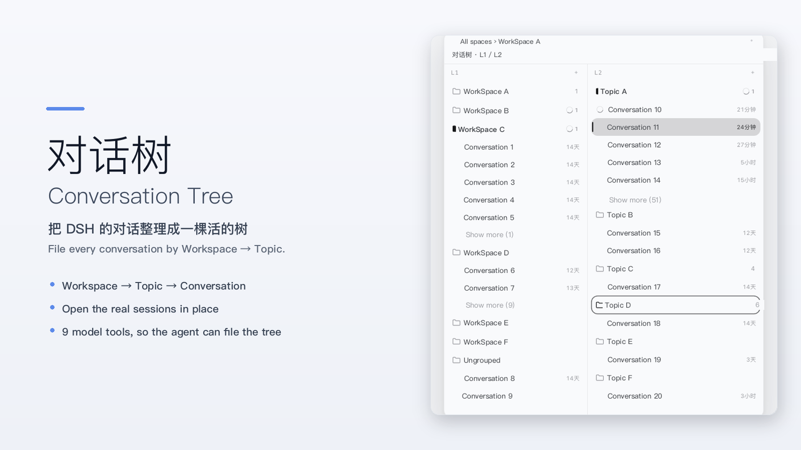
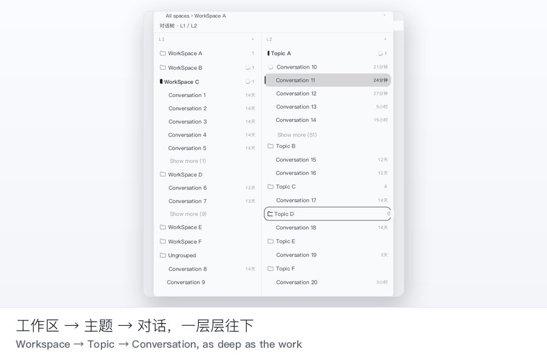
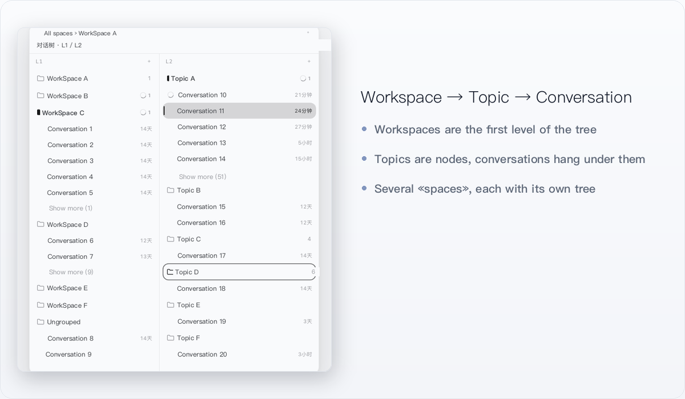
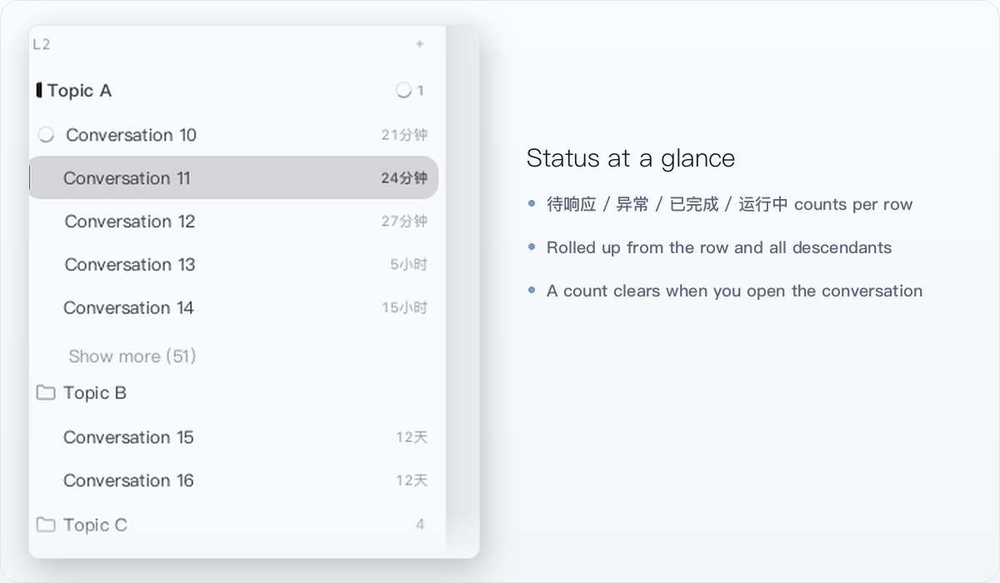

# Conversation Tree (dsh-conversation-tree)

English | [中文](README.zh.md)

[](https://www.npmjs.com/package/dsh-conversation-tree)
[](LICENSE)
[](package.json)
[](https://www.dsh.so/artifact/dsh-conversation-tree-2/)
[](https://awesome-dsh-plugin.com/)



**Turn DSH's conversation list into a living tree — file every conversation under «Workspace → Topic → Conversation», see the status at a glance, and let the model keep the tree tidy for you.**

> Screenshots use demo data: workspace, topic and conversation names are placeholders.

A DeepSeek Harness client plugin that adds a collapsible, resizable **tree band** to the left of the conversation column. The product's own conversation column, header, Chat/Trajectory tabs, right sidebar and composer keep rendering exactly as before — the band reserves a strip on the left and never replaces product UI.

## Install

Requires DSH `>=0.2.1-rc.3` (see `engines.dsh` in `package.json`).

```sh
dsh plugin --profile web add dsh-conversation-tree
```

Then **restart DSH**. The band starts collapsed: a 28×28 icon appears in the conversation header, and the persistent «Conversation Tree» row in the sidebar's panel rows works the same way.

### Install from the plugin index (Discover)

In DSH: **Plugins → Discover → Index sources**, add:

```
https://cdn.jsdelivr.net/gh/orchivo/dsh-plugins-index@main/index.json
```

The index is served over jsDelivr's CDN; adding it to Discover makes the plugin installable from the UI.

### Let the agent install it

Paste this into a DSH conversation:

```text
Install the DSH plugin dsh-conversation-tree for me:
1. Run `dsh plugin --profile web add dsh-conversation-tree`.
2. If it is not found, add the plugin index source
   https://cdn.jsdelivr.net/gh/orchivo/dsh-plugins-index@main/index.json
   in Plugins → Discover → Index sources, then install it there.
3. Tell me to restart DSH when you are done.
```

## 30-second demo



## Three ways people use it

**Multiple WorkSpaces, one tree.** Every WorkSpace is the first level of the tree; each keeps its own conversation list. No more scrolling a single flat list wondering which project a conversation belongs to.

**A long project, filed by topic.** Topics are nodes, conversations hang under them, and a topic can nest as deep as the work does — goal → strategy → tasks. Open a conversation straight from the row; the tree highlight, the product's current session and the right sidebar always stay on the same conversation.

**Let the model keep the tree.** The plugin registers nine tools, so the agent can plan a goal structure, create/rename/move nodes and file existing conversations itself. You can literally ask: «review this thread and file it under the right topic».

## Features

| | |
| --- | --- |
| **Organise, don't replace** — Workspace → topic → conversation, with nested topics and several «spaces» (each one its own tree). | **Status at a glance** — every row rolls up the status of its own conversations and all descendants; a count clears only when you actually open the conversation. |
|  |  |

- **Find it again** — the in-band search covers topic titles/descriptions, indexed conversation titles and conversation bodies (index built on demand inside DSH).
- **Collapsed by default** — a header icon and the sidebar panel row open the same band; the collapsed state is remembered.
- **Bilingual UI** — Simplified Chinese and English, following **Settings → General → Language** and switching live, no restart.
- **Resizable and remembered** — drag the band's right edge (minimum 320px); the conversation column keeps its own minimum width and is never squeezed away.

## What's new in 0.3.0

- **Name a Workspace while you create it** — the `L1` column's ＋ dialog now has a «Workspace name» field under the directory: it fills in from the directory's final segment and can be edited, an already-registered directory keeps its name unless you change it, and a duplicate name is refused in the dialog. The directory picker also stopped moving the dialog while the system panel opens.

## What's new in 0.2.0

- **The tree follows the conversation** — opening, creating or externally navigating to a conversation always lands the tree on that conversation's home (its topic, its Workspace row, the space's «Ungrouped» row or its «Archived» row); ungrouped conversations no longer leave the tree on another branch, and clicking a topic row stays a temporary browse that a reload forgets.
- **Archive per Workspace** — every Workspace ends with an «Archived» shelf: put a topic (with its subtree and conversations) or a single conversation away without freezing it; archived conversations stay openable, searchable and continuable, and the model tools answer `ARCHIVED` instead of touching them.
- **Drag to organise** — drag conversations onto topics (or a Workspace row) and topics onto each other or between siblings; «the topic + its conversations + its footer» is one drop target, with before/after on its 8px edges.
- **Delete asks first** — deleting a topic confirms, then removes its whole subtree at once; its conversations are kept and fall back to the Workspace top level.
- **Conversation home** — the home chain is always a filled brand folder with a bold title, a clicked node is a 1.5px brand outline, and the composer gains a quiet 30px line naming `space › workspace › topic › conversation title` when the selection points away.
- **Quieter chrome, clearer creation** — the new-topic dialog states where the topic will live as a read-only chain, the band's top bar keeps its two rows in every session state, and title tooltips, the start-edge fade, the space badge and the first column now follow real measurements.

## Not the same as a message-branch plugin

There are two different plugins with a similar name, and they solve opposite problems:

| | **Conversation Tree** (this plugin) | **Unintendedz/dsh-conversation-tree** |
| --- | --- | --- |
| Layers | Organisation: Workspace → topic → conversation | Message branch: immutable reply branches inside one conversation |
| Changes DSH UI | Adds a side band only; product UI untouched | Different data model for replies |
| Model tools | 9 tools over the conversation tree | — |

On **dsh.so** the canonical slug `/artifact/dsh-conversation-tree/` belongs to Unintendedz (a different plugin) — our page is [`/artifact/dsh-conversation-tree-2/`](https://www.dsh.so/artifact/dsh-conversation-tree-2/).

## Security & privacy

- **Local data only.** The authoritative document is `$DSH_HOME/conversation-map/map.json`, read and written through the `/conversation-map` RPC channel with optimistic revision locking. The plugin makes no network requests.
- **No network requests.** The plugin never calls home; the only optional network step above is `npm install` / adding the index URL, both of which you start yourself.
- **No npm dependencies, no install scripts.** `package.json` declares no `dependencies`/`devDependencies` and no `install`/`postinstall` script — the published `lib/` is prebuilt.
- **The nine tools only read and write this tree.** They create, rename, move and file nodes and conversations in the map; they do not run commands, scan files or write outside it. `map_delete_nodes` deletes nodes only — conversations under a deleted node fall back to the Workspace root and are never deleted. Search indexing reads the session texts DSH already keeps locally, and stays in the Host process.
- **Degrades safely.** If the product changes the DOM slots the band relies on, it shows a «temporarily unavailable» notice instead of covering the conversation column.

## Compatibility

| | |
| --- | --- |
| DSH | `>=0.2.1-rc.3` (`engines.dsh`) |
| Verified on | DSH `0.2.1-rc.3` — dsh.so L5 runtime verification on npm 0.1.3; also loaded on the DSH desktop `0.2.1-rc.5` build (development link) |
| dsh.so | L5 runtime verification on `0.2.1-rc.3`, low risk, MIT |
| Built as | prebuilt `lib/`; installing needs no build and no toolchain |

## Model tools

The plugin registers nine tools so the model can read and write the tree directly:

| Tool | Purpose |
| --- | --- |
| `map_list_workspaces` | List WorkSpaces |
| `map_get_state` | Read the current document (WorkSpaces, nodes, spaces, conversation filing) |
| `map_plan_goal` | Create a goal + strategy + task structure in one call |
| `map_create_nodes` | Create nodes |
| `map_update_nodes` | Rename / re-describe nodes |
| `map_move_nodes` | Re-parent or reorder nodes |
| `map_move_session` | File a conversation under a node, or rename/move it |
| `map_attach_sessions` | Attach existing conversations to a node |
| `map_delete_nodes` | Delete nodes (`leaf` / `subtree`, requires `confirm`; their conversations are kept and fall back to the Workspace row) |

## Known limitations

- **Depends on public product DOM contracts** (the frame `shell.overlay` slot, the conversation anchor, the header's leading seat, the sidebar-collapsed marker). If they change, the band degrades to a notice; the sidebar panel row keeps working.
- **Single left-band slot**: coordinates with other band plugins through the public `html[data-dsh-band-owner]` attribute.
- **Drag scope**: conversation rows can be dropped on a topic/Workspace row, and topic rows can be re-parented or sibling-ordered («the topic + its conversations + its footer» is the target; its top/bottom 8px mean before/after). Ungrouped content does not drag, cross-Workspace moves are not supported, and spaces cannot be reordered by dragging.
- **No cross-Workspace conversation moves**: ordering applies within one WorkSpace.
- **Single writer**: when the same `$DSH_HOME` is written by several processes, the last writer wins.
- **Windows desktop: not independently verified** (tested on macOS).
- **Search scope**: exact substring matching over titles/descriptions/bodies — no fuzzy matching, segmentation or pinyin.

## Uninstall

```sh
dsh plugin --profile web remove dsh-conversation-tree
```

(or delete the plugin from **Plugins → Installed**). Restart DSH afterwards. Your tree stays in `$DSH_HOME/conversation-map/map.json`, so reinstalling brings it back.

## FAQ

**Does it replace DSH's own conversation list?** No. It adds a band on the left; everything the product renders stays where it was.

**Do I lose my tree if I uninstall?** No — the document lives in `$DSH_HOME/conversation-map/map.json` and is not deleted.

**Does it work in a browser-only / CLI environment?** When the Host half is unavailable the plugin degrades to a browser-local mode and shows «Local mode» in the band.

**Can it touch my files or run commands?** No. The tools only read/write the conversation tree document; there is no shell or filesystem access in the tools.

**Where is the source?** <https://github.com/orchivo/dsh-conversation-tree>. Published to npm prebuilt; building from source needs a DSH source checkout because the project carries no npm dependencies (the bundler and type declarations are borrowed from that checkout).

## License

MIT, see [LICENSE](LICENSE).
