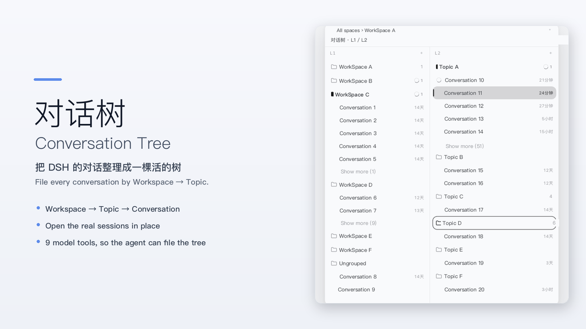
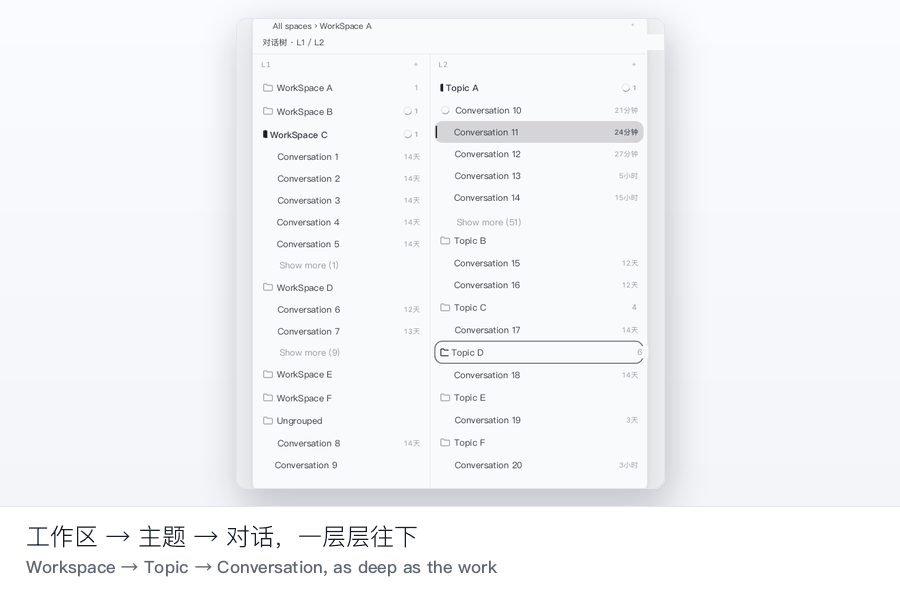
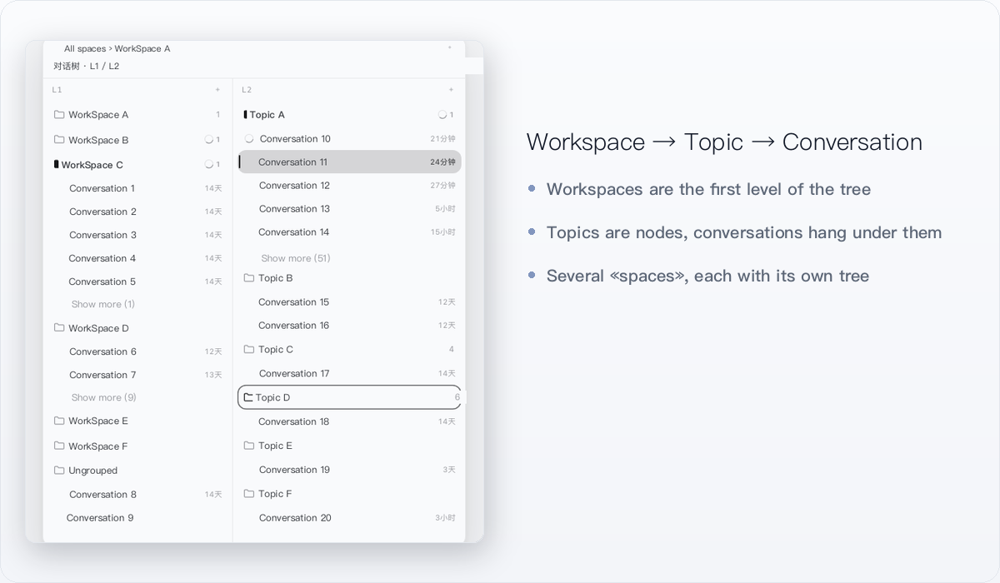
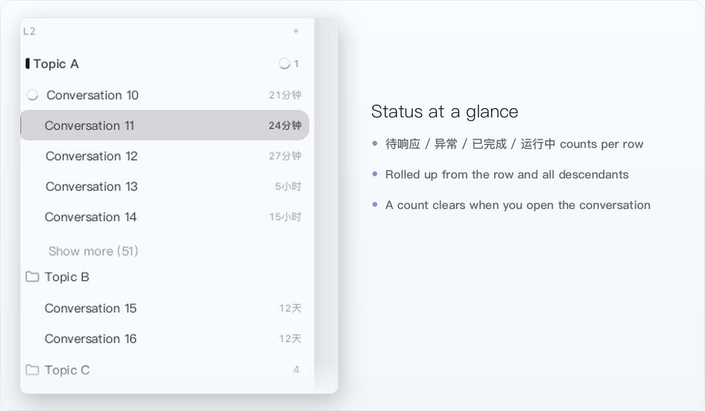

# 对话树（dsh-conversation-tree）

[English](README.md) | 中文

[](https://www.npmjs.com/package/dsh-conversation-tree)
[](LICENSE)
[](package.json)
[](https://www.dsh.so/zh/artifact/dsh-conversation-tree-2/)
[](https://awesome-dsh-plugin.com/p/chriswang/dsh-conversation-tree/)



**把 DSH 的对话整理成一棵活的树——按「工作区 → 主题 → 对话」归档，状态一眼看清，还能让 AI 自己整理。**

> 截图为演示数据：工作区、主题、会话名均为占位符，已脱敏。

一个 DeepSeek Harness 客户端插件：在会话列左侧加一条可折叠、可拖拽宽度的**对话树栏**。产品自己的会话列、标题栏、对话/轨迹标签、右侧栏和输入框都照常渲染——树栏只在左边占一条，从不替换产品 UI。

## 安装

需要 DSH `>=0.2.1-rc.3`（见 `package.json` 的 `engines.dsh`）。

```sh
dsh plugin --profile web add dsh-conversation-tree
```

装完**重启 DSH**。树栏默认收起：会话头部出现一枚 28×28 图标，侧栏面板行里常驻的「对话树」一行同样可以展开。

### 从插件索引安装（Discover）

DSH 里打开 **插件 → 发现（Discover）→ 索引源（Index sources）**，添加：

```
https://cdn.jsdelivr.net/gh/chriswang/dsh-plugins-index@main/index.json
```

索引走 jsDelivr CDN；加进「发现」后即可在插件列表里直接安装。

### 让 agent 自己装

把下面这段贴进 DSH 对话：

```text
帮我安装 DSH 插件 dsh-conversation-tree：
1. 执行 `dsh plugin --profile web add dsh-conversation-tree`。
2. 如果找不到，在「插件 → 发现 → 索引源」里添加
   https://cdn.jsdelivr.net/gh/chriswang/dsh-plugins-index@main/index.json
   再从插件列表安装。
3. 装完提醒我重启 DSH。
```

## 30 秒演示



## 三个使用场景

**多个工作区，一棵树。** 每个工作区都是树的第一层，各自保留自己的对话清单。不用再翻一张扁平列表猜「这条对话是哪个项目的」。

**长项目，按主题归档。** 主题是节点，对话挂在节点下；主题可以按工作本身的层次往下长——目标 → 策略 → 任务。点行就直接打开真实会话，树的高亮、产品当前会话和右侧栏始终指向同一条对话。

**让模型自己整理树。** 插件注册了 9 个模型工具，agent 可以自己规划目标结构、建节点、改名、移动，并把已有对话归档进去。你可以直接说：「看一遍这条对话，帮我归档到合适的主题下」。

## 功能

| | |
| --- | --- |
| **只做组织，不替换产品** —— 工作区 → 主题 → 对话，主题可嵌套，支持多个「空间」，每个空间一棵树。 | **状态一眼看清** —— 每一行汇总自己 + 全部下游节点的会话状态；只有真的打开那条对话，角标才清除。 |
|  |  |

- **找得回来** —— 栏内搜索覆盖主题标题/描述、已索引的会话标题和会话正文（正文索引在 DSH 进程内按需建立）。
- **默认收起** —— 会话头部图标与侧栏面板行走同一个入口，折叠状态会被记住。
- **中英双语 UI** —— 跟随「设置 → 通用 → 语言」实时切换，不用重启。
- **宽度可拖、状态记住** —— 拖右侧边缘调整宽度（最小 320px）；会话列保留自己的最小宽度，不会被挤没。

## 与「消息分支」插件不是一回事

有两个名字相近的插件，解决的是相反的问题：

| | **对话树（本插件）** | **Unintendedz/dsh-conversation-tree** |
| --- | --- | --- |
| 层次 | 组织层：工作区 → 主题 → 对话 | 消息层：单条对话内不可变的回复分支 |
| 是否改 DSH UI | 只在旁边加一条树栏，产品 UI 不动 | 另一套回复数据模型 |
| 模型工具 | 9 个，读写这棵对话树 | — |

在 **dsh.so** 上规范 slug `/artifact/dsh-conversation-tree/` 归 Unintendedz，所以请认 **`@chriswang/dsh-conversation-tree`**——我们的是 [`/artifact/dsh-conversation-tree-2/`](https://www.dsh.so/zh/artifact/dsh-conversation-tree-2/)。

## 安全与隐私

- **数据只在本地。** 权威文档是 `$DSH_HOME/conversation-map/map.json`，通过 `/conversation-map` RPC 通道读写，带乐观版本锁；插件不做任何网络请求。
- **没有网络请求。** 插件不联网；上面唯一涉及网络的是 `npm install` 和自行添加索引地址，都由你发起。
- **无 npm 依赖、无 install 脚本。** `package.json` 没有 `dependencies`/`devDependencies`，也没有 `install`/`postinstall`；npm 上是预构建好的 `lib/`。
- **9 个工具只读写这棵树。** 它们在对话树文档里建/改名/移动/归档节点与会话，不执行命令、不扫描文件、不写别处。`map_delete_nodes` 只删节点——节点下的会话会回落到工作区顶层，会话本身不会被删除。搜索索引读取 DSH 本来就在本地保存的会话文本，且只发生在 Host 进程内。
- **降级安全。** 产品 DOM 契约变化时，树栏显示「暂不可用」提示，而不是盖住会话列；侧栏面板行入口照常可用。

## 兼容矩阵

| | |
| --- | --- |
| DSH | `>=0.2.1-rc.3`（`engines.dsh`） |
| 实测运行 | DSH `0.2.1-rc.3`——npm 0.1.3 在 dsh.so 上通过 L5 运行验证；另在 DSH 桌面版 `0.2.1-rc.5` 构建上以开发链接加载过 |
| dsh.so | `0.2.1-rc.3` 上通过 L5 运行验证，低风险、MIT |
| 分发形式 | 预构建 `lib/`；安装不需要构建，也不需要工具链 |

## 模型工具

插件注册 9 个工具，让模型直接读写这棵树：

| 工具 | 用途 |
| --- | --- |
| `map_list_workspaces` | 列出工作区 |
| `map_get_state` | 读取当前文档（工作区、节点、空间、对话归档） |
| `map_plan_goal` | 一次调用建好「目标 + 策略 + 任务」结构 |
| `map_create_nodes` | 新建节点 |
| `map_update_nodes` | 改名 / 改描述 |
| `map_move_nodes` | 改父节点或排序 |
| `map_move_session` | 把对话归档到节点下，或改名/移动 |
| `map_attach_sessions` | 把已有对话挂到节点上 |
| `map_delete_nodes` | 删除节点（含子树） |

## 已知限制

- **依赖产品公开 DOM 契约**（frame 的 `shell.overlay` 槽位、会话锚点、会话头部首位、侧栏收起标记）。它们变化时树栏降级为提示，侧栏面板行入口仍可用。
- **左侧带槽位是独占的**：通过公开的 `html[data-dsh-band-owner]` 属性与其他带状插件协调。
- **拖拽范围有限**：改父节点走 `⋯` 菜单；主题不支持拖拽。空间不支持拖拽排序。
- **跨工作区不移动对话**：排序只在单个工作区内生效。
- **单写者**：同一个 `$DSH_HOME` 被多个进程写时，后写覆盖先写。
- **Windows 桌面版未独立验证**（本次只在 macOS 上实测）。
- **搜索范围**：对标题/描述/正文做精确子串匹配，不做模糊匹配、分词或拼音。

## 卸载

```sh
dsh plugin --profile web remove dsh-conversation-tree
```

（也可以在「插件 → 已安装」里删除。）之后重启 DSH。你的树还在 `$DSH_HOME/conversation-map/map.json` 里，重新装回即可恢复。

## 常见问题

**会替换 DSH 自己的会话列表吗？** 不会。它只在左侧加一条树栏，产品原本渲染的东西都还在原处。

**卸载会丢树吗？** 不会。文档在 `$DSH_HOME/conversation-map/map.json`，不会被删除。

**浏览器独占 / CLI 环境能用吗？** Host 半不可用时会降级为浏览器本地模式，并在树栏里显示「本地模式」。

**它会碰我的文件或执行命令吗？** 不会。工具只读写对话树文档，没有 shell 和文件系统访问。

**源码在哪？** <https://github.com/chriswang/dsh-conversation-tree>。npm 上是预构建产物；从源码构建需要 DSH 源码 checkout，因为本项目刻意不带 npm 依赖（打包器和类型声明都借用那份 checkout）。

## 许可证

MIT，见 [LICENSE](LICENSE)。
